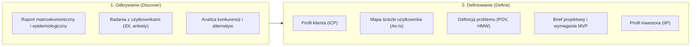
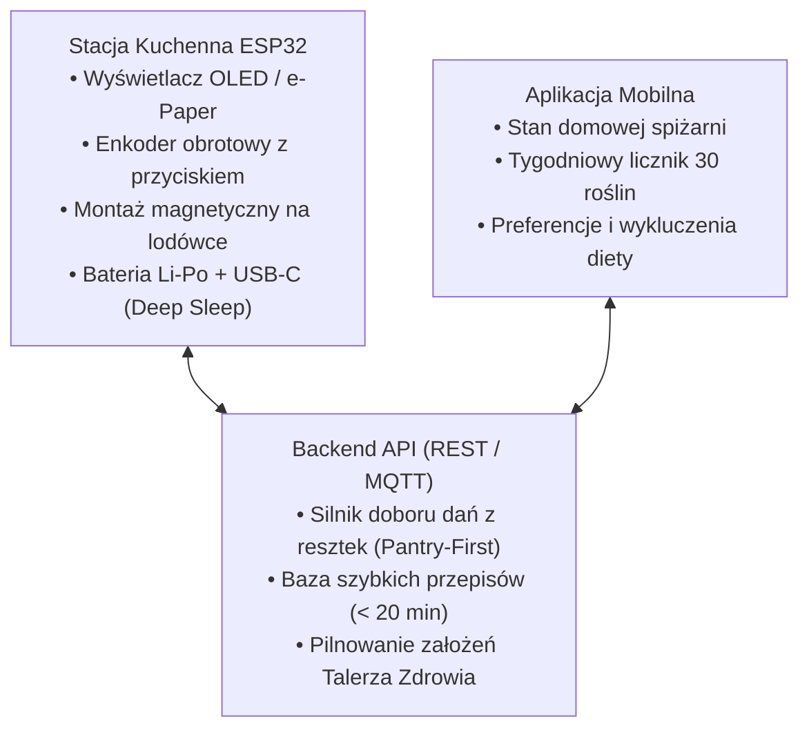

# Stacja Kuchenna IoT & Aplikacja Mobilna

Zintegrowany system hardware-software (fizyczna stacja kuchenna na mikrokontrolerze ESP32 montowana magnetycznie na lodówce + powiązana aplikacja mobilna) rozwiązujący problem wieczornego paraliżu decyzyjnego, monotonii żywieniowej oraz marnotrawstwa żywności w gospodarstwach domowych.

Projekt prowadzony w metodyce **Double Diamond** (Discover, Define, Develop, Deliver) z wykorzystaniem podejścia **Human-Centered Design (HCD)**.

---

## Spis Treści

1. [Struktura 1. Diamentu Projektowego](#struktura-1-diamentu-projektowego)
2. [Wykaz Dokumentacji i Rezultatów](#wykaz-dokumentacji-i-rezultatów)
3. [Architektura Systemu](#architektura-systemu)
4. [Status Prac: 2. Diament (Develop & Deliver)](#status-prac-2-diament-develop--deliver)
5. [Licencja](#licencja)

---

## Struktura 1. Diamentu Projektowego

Prace analityczne i badawcze zostały zrealizowane w ramach dwóch pierwszych faz procesu projektowego:

---

## Wykaz Dokumentacji i Rezultatów

### Faza 1: Odkrywanie (Discover)

| Dokument | Obszar analityczny | Zawartość i wnioski |
| :--- | :--- | :--- |
| [Raport_Ekosystem_Zywieniowy_Polska.md](Raport_Ekosystem_Zywieniowy_Polska.md) | Analiza rynkowa i epidemiologiczna | Dane NIZP PZH, WOBASZ II, PolSenior2, budżetów GUS 2011–2024, projektu PROM (4,84 mln t marnowanej żywności) oraz standard American Gut Project (próg 30 roślin tygodniowo). |
| [badania_i_wnioski.md](badania_i_wnioski.md) | Badania jakościowe i ilościowe | 8 wywiadów IDI z obserwacją w kuchni oraz ankieta online (N = 142). Zmęczenie decyzyjne po pracy jako główna przyczyna ucieczki w drogie jedzenie z dowozu. |
| [analiza_konkurencji.md](analiza_konkurencji.md) | Benchmarking rynkowy | Zestawienie 5 kategorii alternatyw: aplikacje dietetyczne, portale z przepisami, catering pudełkowy, roboty kuchenne (Thermomix) i metody tradycyjne. |

### Faza 2: Definiowanie (Define)

| Dokument | Narzędzie projektowe | Zawartość i wnioski |
| :--- | :--- | :--- |
| [profil_idealnego_klienta_icp.md](profil_idealnego_klienta_icp.md) | Profil klienta (ICP) | Charakterystyka młodego pracownika umysłowego (20–34 lata, praca hybrydowa, paraliż decyzyjny przy lodówce, wyrzucanie zepsutych resztek). |
| [mapa_sciezki_klienta_as_is.md](mapa_sciezki_klienta_as_is.md) | Customer Journey Map (As-Is) | 6 etapów: od zmęczenia po pracy o 17:30, przez irytację smartfonem w kuchni, po wyrzucanie resztek do kosza (strata 12–16 h i 250–400 zł miesięcznie). |
| [definicja_problemu.md](definicja_problemu.md) | Problem Statement & VPC | Analiza 5 Why, zdefiniowane stanowisko POV, 5 pytań How Might We (HMW) oraz dopasowanie propozycji wartości (Value Proposition Canvas). |
| [design_brief.md](design_brief.md) | Karta projektu i specyfikacja MVP | Zakres funkcjonalny MoSCoW, ograniczenia środowiskowe (IP54, para, tłuszcz), zasilanie (Deep Sleep, Li-Po), budżet BOM (< 70–80 zł) oraz 8-tygodniowy harmonogram (4 sprinty). |
| [profil_idealnego_inwestora_iip.md](profil_idealnego_inwestora_iip.md) | Profil inwestora (IIP) | Tezy inwestycyjne w modelu Hardware-Enabled SaaS pod fundusze FoodTech, Sustainability, sieci retail/e-grocery oraz fundusze prewencji zdrowotnej. |

---

## Architektura Systemu

System łączy prostotę interfejsu stacji kuchennej z logiką chmurową i mobilną:

---

## Status Prac: 2. Diament (Develop & Deliver)

W ramach drugiego diamentu realizowane są:
1. **Hardware i obudowa:** Schemat połączeń ESP32, układ ładowania TP4056 i projekt obudowy CAD pod druk 3D z mocowaniem magnetycznym.
2. **Firmware:** Oprogramowanie w C++/Arduino z obsługą wybudzania przerwaniem sprzętowym, komunikacją Wi-Fi i obsługą kroków z minutnikiem.
3. **Aplikacja mobilna:** Moduł spiżarni z prostym kategoryzowaniem produktów oraz śledzeniem różnorodności roślinnej w diecie.

---

## Licencja

Projekt udostępniany na zasadach licencji [MIT](LICENSE).
