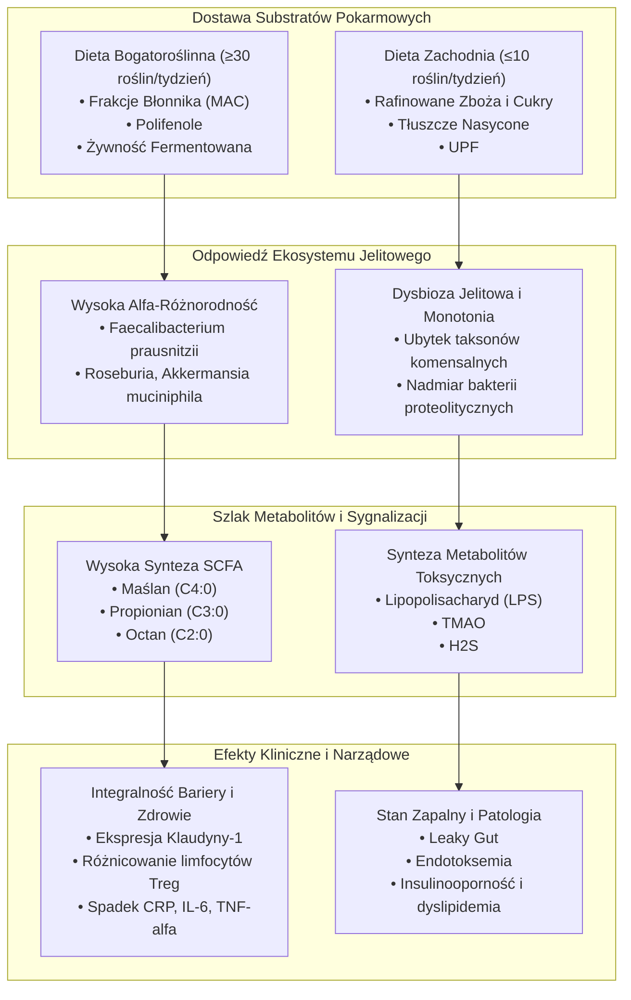
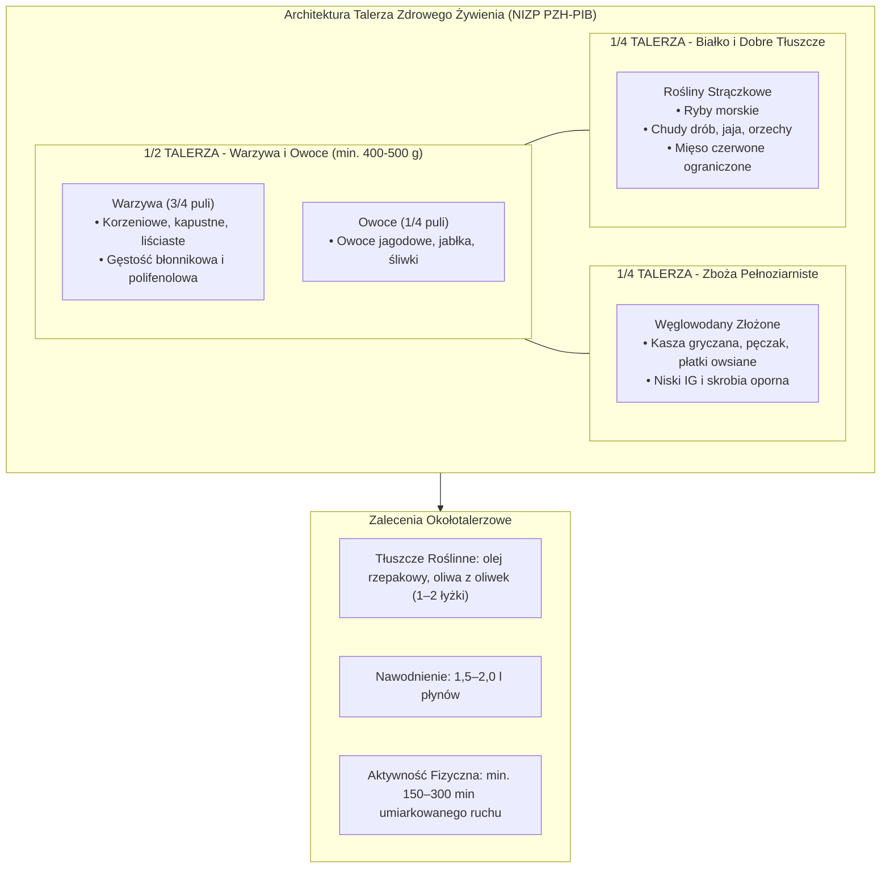
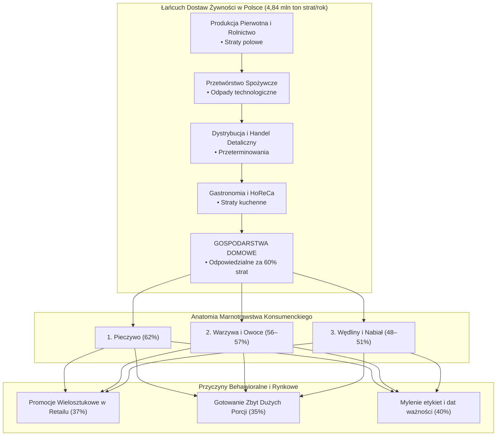
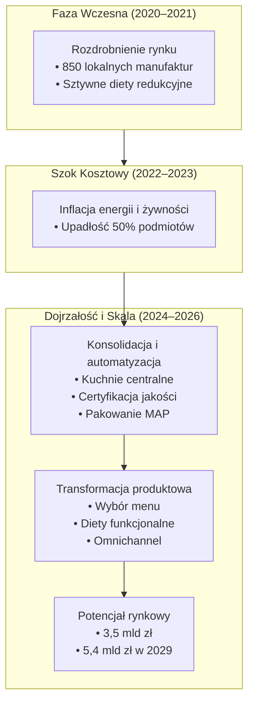
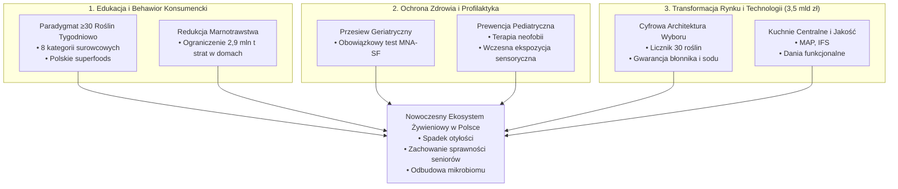

# Wielowymiarowa Analiza Ekosystemu Żywieniowego w Polsce: Epidemiologia, Bioróżnorodność Mikrobiomu, Ekonomika Konsumpcji i Transformacja Rynku Convenience

> **Dokument Analityczno-Kliniczny i Raport Rynkowy**  
> *Opracowano na podstawie danych epidemiologicznych (NIZP PZH–PIB, WOBASZ, WOBASZ II, PolSenior, PolSenior2), makroekonomicznych (GUS 2011–2024, PROM), badań klinicznych mikrobiomu (American Gut, metaanalizy mikrobiomu jelitowego) oraz analiz rynkowych sektora convenience i cateringu dietetycznego.*
---

## Spis Treści
1. [Wprowadzenie i Synteza Wykonawcza (Executive Summary)](#wprowadzenie-i-synteza-wykonawcza)
2. [1. Paradygmat Różnorodności Żywieniowej i Mikrobiom Jelitowy w Świetle Badań Klinicznych](#1-paradygmat-różnorodności-żywieniowej-i-mikrobiom-jelitowy-w-świetle-badań-klinicznych)
   - [1.1. Diagnostyka Jakości Diety: Wskaźniki DDS, FVS, FAD i Tygodniowy Indeks Roślinny](#11-diagnostyka-jakości-diety-wskaźniki-dds-fvs-fad-i-tygodniowy-indeks-roślinny)
   - [1.2. Ontogeneza Mikrobiomu a Bioróżnorodność Talerza: Od Niemowląt po Geriatrię](#12-ontogeneza-mikrobiomu-a-bioróżnorodność-talerza-od-niemowląt-po-geriatrię)
   - [1.3. Odkrycia American Gut Project: Paradygmat ≥ 30 Roślin Tygodniowo](#13-odkrycia-american-gut-project-paradygmat--30-roślin-tygodniowo)
   - [1.4. Mechanizmy Molekularne i Szlaki Krótkołańcuchowych Kwasów Tłuszczowych (SCFA)](#14-mechanizmy-molekularne-i-szlaki-krótkołańcuchowych-kwasów-tłuszczowych-scfa)
   - [1.5. Praktyczny System 8 Kategorii Surowcowych i Protokół Adaptacyjny](#15-praktyczny-system-8-kategorii-surowcowych-i-protokół-adaptacyjny)
3. [2. Diagnoza Epidemiologiczna Stanu Odżywienia Populacji Polski: Od Neofobii Dziecięcej po Geriatryczne Niedożywienie](#2-diagnoza-epidemiologiczna-stanu-odżywienia-populacji-polski-od-neofobii-dziecięcej-po-geriatryczne-niedożywienie)
   - [2.1. Ramy Referencyjne i System Norm Żywienia NIZP PZH–PIB](#21-ramy-referencyjne-i-system-norm-żywienia-nizp-pzhpib)
   - [2.2. Skala Zaburzeń Metabolicznych i Epidemiologia Masy Ciała (WOBASZ i WOBASZ II)](#22-skala-zaburzeń-metabolicznych-i-epidemiologia-masy-ciała-wobasz-i-wobasz-ii)
   - [2.3. Trzy Strukturalne Deficyty Polskiej Diety: Błonnik, Sód i Baza Warzywna](#23-trzy-strukturalne-deficyty-polskiej-diety-błonnik-sód-i-baza-warzywna)
   - [2.4. Syntetyczny Dashboard Wskaźników Epidemiologicznych](#24-syntetyczny-dashboard-wskaźników-epidemiologicznych)
   - [2.5. Neofobia Żywieniowa w Wieku Pediatrycznym (Skala FNS)](#25-neofobia-żywieniowa-w-wieku-pediatrycznym-skala-fns)
   - [2.6. Geriatryczny Kryzys Niedożywienia Białkowo-Energetycznego (PolSenior i PolSenior2)](#26-geriatryczny-kryzys-niedożywienia-białkowo-energetycznego-polsenior-i-polsenior2)
4. [3. Architektura Wyboru i Ewolucja Zaleceń Żywieniowych: Talerz Zdrowego Żywienia wobec Globalnych Trendów](#3-architektura-wyboru-i-ewolucja-zaleceń-żywieniowych-talerz-zdrowego-żywienia-wobec-globalnych-trendów)
   - [3.1. Ewolucja Modeli Wizualnych: Od Piramidy (2016) do Talerza Zdrowia (2020–2026)](#31-ewolucja-modeli-wizualnych-od-piramidy-2016-do-talerza-zdrowia-20202026)
   - [3.2. Geometria Talerza i Trzystopniowa Matryca Behawioralna](#32-geometria-talerza-i-trzystopniowa-matryca-behawioralna)
   - [3.3. Komparatywna Analiza Modeli Międzynarodowych](#33-komparatywna-analiza-modeli-międzynarodowych)
   - [3.4. Kliniczna Efektywność Kontroli Porcji i Behawioralna Metoda Małych Kroków](#34-kliniczna-efektywność-kontroli-porcji-i-behawioralna-metoda-małych-kroków)
5. [4. Makroekonomika Konsumpcji Żywności w Polsce: Budżety Gospodarstw Domowych, Polaryzacja i Marnotrawstwo](#4-makroekonomika-konsumpcji-żywności-w-polsce-budżety-gospodarstw-domowych-polaryzacja-i-marnotrawstwo)
   - [4.1. Transformacja Siły Nabywczej: Szereg Czasowy GUS 2011–2024](#41-transformacja-siły-nabywczej-szereg-czasowy-gus-20112024)
   - [4.2. Działanie Prawa Engla i Głęboka Polaryzacja Społeczno-Ekonomiczna](#42-działanie-prawa-engla-i-głęboka-polaryzacja-społeczno-ekonomiczna)
   - [4.3. Zróżnicowanie Regionalne Koszyka Konsumpcyjnego](#43-zróżnicowanie-regionalne-koszyka-konsumpcyjnego)
   - [4.4. Skala, Struktura i Przyczyny Marnotrawstwa Żywności (Projekt PROM)](#44-skala-struktura-i-przyczyny-marnotrawstwa-żywności-projekt-prom)
6. [5. Komercjalizacja Zdrowego Żywienia: Dynamika, Konsolidacja i Ewolucja Rynku Cateringu Dietetycznego](#5-komercjalizacja-zdrowego-żywienia-dynamika-konsolidacja-i-ewolucja-rynku-cateringu-dietetycznego)
   - [5.1. Paradoks Intencji i Luki Czasowej w Polskich Gospodarstwach Domowych](#51-paradoks-intencji-i-luki-czasowej-w-polskich-gospodarstwach-domowych)
   - [5.2. Skala i Wycena Rynku Diety Pudełkowej w Polsce](#52-skala-i-wycena-rynku-diety-pudełkowej-w-polsce)
   - [5.3. Trzy Filary Dojrzałości i Ewolucji Rynkowej](#53-trzy-filary-dojrzałości-i-ewolucji-rynkowej)
     - [5.3.1. Dojrzewanie i Silna Konsolidacja Podmiotowa](#531-dojrzewanie-i-silna-konsolidacja-podmiotowa)
     - [5.3.2. Demokratyzacja Usługi i Zachowania Omnichannelowe](#532-demokratyzacja-usługi-i-zachowania-omnichannelowe)
     - [5.3.3. Od Redukcji Masy Ciała do Ko-kreacji i Żywienia Funkcjonalnego](#533-od-redukcji-masy-ciała-do-ko-kreacji-i-żywienia-funkcjonalnego)
7. [6. Wnioski Systemowe i Implikacje Strategiczne](#6-wnioski-systemowe-i-implikacje-strategiczne)
   - [6.1. Priorytet I: Przeformułowanie Celów Edukacji na Bioróżnorodność i Gęstość Błonnikową](#61-priorytet-i-przeformułowanie-celów-edukacji-na-bioróżnorodność-i-gęstość-błonnika)
   - [6.2. Priorytet II: Systemowy Przesiew Geriatryczny i Wczesna Interwencja Pediatryczna](#62-priorytet-ii-systemowy-przesiew-geriatryczny-i-wczesna-interwencja-pediatryczna)
   - [6.3. Priorytet III: Niwelowanie Barier Dochodowych i Ograniczenie Strat Żywności](#63-priorytet-iii-niwelowanie-barier-dochodowych-i-ograniczenie-strat-żywności)
   - [6.4. Priorytet IV: Sektor Convenience i Catering Jako Narzędzie Polityki Zdrowia Publicznego](#64-priorytet-iv-sektor-convenience-i-catering-jako-narzędzie-polityki-zdrowia-publicznego)
8. [Bibliografia i Wykaz Źródeł Referencyjnych](#bibliografia-i-wykaz-źródeł-referencyjnych)

---

## Wprowadzenie i Synteza Wykonawcza

Współczesny ekosystem żywieniowy w Polsce znajduje się w punkcie krytycznej transformacji, w którym zaawansowana wiedza z zakresu mikrobiologii klinicznej i epidemiologii żywieniowej łączy się z presją makroekonomiczną, demograficzną i rynkową. Z jednej strony badania populacyjne jednoznacznie wskazują na utrzymywanie się głębokich, systemowych błędów żywieniowych:

* Drastyczny niedobór błonnika pokarmowego: średnie spożycie u dorosłych wynosi poniżej $18\ \text{g/dobę}$ wobec normy referencyjnej WHO wynoszącej $25{-}30\ \text{g/dobę}$.
* Toksyczna nadpodaż sodu: przeciętne dzienne spożycie soli kuchennej wynosi aż $11{,}5\ \text{g/dobę}$, co ponad dwukrotnie przekracza bezpieczny pułap ustalony przez WHO i NIZP PZH (maks. $5\ \text{g/dobę}$).
* Epidemia nadwagi i otyłości: nadmierna masa ciała ($BMI \ge 25\ \text{kg/m}^2$) dotyka niemal $49\%$ dorosłych Polek i odpowiada za utratę średnio $12{,}4\%$ lat przeżytych w zdrowiu.
* Kryzys niedożywienia geriatrycznego: badanie PolSenior2 dowodzi, że aż $28{,}1\%$ osób w wieku $60+$ w Polsce wykazuje pełnoobjawowe niedożywienie ($2{,}8\%$) lub bezpośrednie ryzyko jego rozwoju.

Z drugiej strony Polska wykształciła unikalny w skali europejskiej rynek cateringu dietetycznego wyceniany w 2024 roku na $3{,}5\ \text{mld zł}$, który stanowi komercyjną odpowiedź na brak czasu, trudności kulinarne i rosnącą świadomość prozdrowotną.

Zrozumienie powiązań między biologicznymi mechanizmami różnorodności pokarmowej a strukturą wydatków budżetowych GUS, gigantycznym marnotrawstwem żywności ($4{,}84\ \text{mln ton rocznie}$, z czego ponad $60\%$ powstaje w gospodarstwach domowych) oraz rynkową infrastrukturą cateringową wymaga podejścia systemowego i ilościowego.

### Kluczowe Metryki Ekosystemu Żywieniowego w Polsce

| Obszar Analityczny | Wskaźnik Rzeczywisty w Polsce | Norma Referencyjna / Standard | Status Kliniczno-Społeczny |
| :--- | :--- | :--- | :--- |
| **Spożycie błonnika pokarmowego** | **< 18 g/dobę** (kobiety: $17{,}5\ \text{g}$, mężczyźni: $20{,}9\ \text{g}$) | **$25{-}30\ \text{g/dobę}$** (AI NIZP PZH / WHO) | Niski poziom i brak gęstości błonnikowej |
| **Podaż soli kuchennej (sodu)** | **$11{,}5\ \text{g/dobę}$** | **maks. $5\ \text{g/dobę}$** | Przekroczenie o $130\%$ |
| **Masa ciała dorosłych kobiet** | **$49\%$ z nadmierną masą ciała** | $BMI \in [18{,}5, 24{,}9]\ \text{kg/m}^2$ | Utrata $12{,}4\%$ lat przeżytych w zdrowiu |
| **Stan odżywienia seniorów 60+ (MNA-SF)** | **$28{,}1\%$ zaburzeń** | Pełny stan odżywienia ($> 11$ pkt) | Ukryty kryzys geriatryczny |
| **Tygodniowa różnorodność roślinna** | **średnio ok. $6$ gatunków roślin** | **$\ge 30$ gatunków roślin/tydzień** | Niska bioróżnorodność mikrobiomu |
| **Wartość rynku cateringu dietetycznego** | **$3{,}5\ \text{mld zł}$ w 2024 r.** | Rynek rozwinięty i stabilny | Światowy lider penetracji innowacyjnej |
| **Marnotrawstwo żywności (PROM)** | **$4\ 840\ 946\ \text{t/rok}$** | Zero Waste / cel SDG 12.3 | $153\ \text{kg/osobę}$ w domach |

---

## 1. Paradygmat Różnorodności Żywieniowej i Mikrobiom Jelitowy w Świetle Badań Klinicznych

W nowoczesnej nauce o żywieniu punkt ciężkości przesuwa się z izolowanej analizy pojedynczych makroskładników (białek, tłuszczów, węglowodanów) w stronę całościowej oceny bioróżnorodności diety i jej wpływu na mikrobiom jelitowy. Kluczowy mechanizm zdrowotny jest wyraźny: im większa różnorodność składników pokarmowych, tym większa różnorodność sensomotoryczna, fermentacyjna i immunologiczna przewodu pokarmowego.

### 1.1. Diagnostyka Jakości Diety: Wskaźniki DDS, FVS, FAD i Tygodniowy Indeks Roślinny

Do obiektywnej kwantyfikacji urozmaicenia jadłospisu wykorzystuje się zwalidowane indeksy jakości diety, przede wszystkim wskaźnik różnorodności diety (DDS), wskaźnik różnorodności produktów (FVS), wskaźnik różnorodności alergenowej (FAD) oraz tygodniowy indeks roślinny (AGP).

| Wskaźnik diagnostyczny | Definicja operacyjna i zakres pomiarowy | Zastosowanie kliniczne i punkty odcięcia | Kluczowe korelacje zdrowotne i metaboliczne |
| :--- | :--- | :--- | :--- |
| **Dietary Diversity Score (DDS)** | Liczba unikalnych grup produktów spożywczych | Używany do oceny jakości diety i adekwatności odżywiania | Koreluje z mikrobiotą, immunoregulacją i redukcją ryzyka przewlekłego stanu zapalnego |
| **Food Variety Score (FVS)** | Bezwzględna liczba pojedynczych, unikalnych artykułów spożywczych | Ocena szerokości repertoaru pokarmowego, zwłaszcza w dzieciństwie i geriatrii | Współistnieje z lepszą homeostazą metaboliczną |
| **Food Allergen Diversity (FAD)** | Liczba potencjalnych alergenów wprowadzonego do diety | Ocena ekspozycji immunologicznej i tolerancji | Ważna w kontekście rozwoju tolerancji immunologicznej |
| **Tygodniowy indeks roślinny (AGP)** | Liczba unikalnych gatunków i odmian roślin spożywanych w tygodniu | $\le 10$ gatunków = dieta zachodnia; $\ge 30$ = wzorzec wysokiej różnorodności | Silny korelat alfa-różnorodności mikrobiomu |

### 1.2. Ontogeneza Mikrobiomu a Bioróżnorodność Talerza: Od Niemowląt po Geriatrię

Mechanizmy łączące wysokie wartości wskaźników DDS i FVS z homeostazą ustrojową ujawniają się na każdym etapie życia:

* **Okres niemowlęcy i wczesnodziecięcy (programowanie mikrobioty)**: wcześniejsze wprowadzenie szerszego wachlarza pokarmów jest związane z większą obfitością bakterii produkujących maślan, w tym *Flavonifractor plautii*.
* **Populacja geriatryczna (prewencja zespołu słabości)**: wysoka wartość wskaźnika FVS pełni funkcję ochronną przed rozwojem frailty syndrome. Osoby starsze utrzymujące wysoką różnorodność spożywanych produktów charakteryzują się istotnie niższym indeksem słabości ($FI \le 0{,}25$).
* **Patologia chorób autoimmunologicznych (np. SLE)**: pacjenci z toczniem rumieniowatym układowym wykazują wyższy wskaźnik masy ciała ($BMI = 26{,}63 \pm 5{,}02\ \text{kg/m}^2$) i niższą różnorodność diety, co jest związane z wyższym stanem zapalnym i ograniczoną adekwatnością żywieniową.

### 1.3. Odkrycia American Gut Project: Paradygmat ≥ 30 Roślin Tygodniowo

> [!IMPORTANT]
> **Kluczowe Odkrycie American Gut Project**:
> Osoby spożywające tygodniowo co najmniej $30$ różnych gatunków roślin cechują się radykalnie wyższą $\alpha$-różnorodnością mikrobiologiczną jelit oraz znacznie niższym ryzykiem przewlekłego stanu zapalnego.
>
> Co przełomowe: sama liczba unikalnych gatunków roślin w tygodniowym menu silniej determinuje różnorodność mikrobiomu niż deklarowanie diety wegańskiej, wegetariańskiej czy wszystkożernej.

### 1.4. Mechanizmy Molekularne i Szlaki Krótkołańcuchowych Kwasów Tłuszczowych (SCFA)

Fizjologiczna efektywność zróżnicowanej diety roślinnej wynika z synergii unikalnych struktur włókna pokarmowego (MAC – Microbiota-Accessible Carbohydrates) oraz polifenoli. Odmienne gatunki bakterii komensalnych wykazują ścisłą specjalizację enzymatyczną w degradacji poszczególnych wiązań chemicznych polisacharydów, syntetyzując krótkołańcuchowe kwasy tłuszczowe (SCFA):

* **Octan ($C_2$, ok. $60\%$)**: przechodzi do krążenia wrotnego i obwodowego, służąc jako substrat energetyczny dla mięśni, serca i mózgu oraz modulując lipogenezę wątrobową.
* **Propionian ($C_3$, ok. $20\%$)**: wychwytywany w wątrobie, hamuje syntezę cholesterolu de novo oraz uczestniczy w regulacji glukoneogenezy i wydzielania hormonów sytości (GLP-1, PYY).
* **Maślan ($C_4$, ok. $20\%$)**: podstawowe źródło energii dla kolonocytów, kluczowy regulator ekspresji genów.

```text
POLISACHARYDY ROŚLINNE (MAC) + POLIFENOLE
                    │
         Fermentacja przez mikrobiotę jelitową
                    │
      ┌─────────────┼─────────────┐
      ▼             ▼             ▼
   OCTAN (60%)   PROPIONIAN (20%)   MAŚLAN (20%)
      │             │               │
  Mięśnie i mózg   Wątroba i GLP-1  Paliwo kolonocytów
  FFAR2 / FFAR3    Regulacja       Hamowanie HDAC
                  lipidowa        Ekspresja MUC2, CLDN1
```

#### Kluczowe Efekty Narządowe SCFA:
1. **Integralność bariery jelitowej**: maślan stymuluje transkrypcję genów kodujących białka połączeń ścisłych (*tight junctions*): okludynę, klaudynę-1 oraz syntezę mucyny 2.
2. **Aktywacja receptorów sprzężonych z białkiem G**: SCFA wiążą się z receptorami FFAR2 (GPR43), FFAR3 (GPR41) oraz GPR109A (HCAR2) na leukocytach i komórkach enteroendokrynnym.
3. **Hamowanie deacetylaz histonowych (HDAC)**: maślan indukuje różnicowanie limfocytów regulatorowych $T_{reg}$ ($CD4^+Foxp3^+$), kluczowych w tolerancji immunologicznej.
4. **Oś jelito–mózg**: sygnalizacja SCFA stymuluje syntezę serotoniny i dopaminy, modulując neurogenezę, apetyt i cierpienie psychiczne.

> [!TIP]
> **Dowody z Randomizowanych Badań Klinicznych (RCT)**:
> * W 6-tygodniowym badaniu interwencyjnym obejmującym 81 dorosłych zastąpienie zbóż rafinowanych pełnoziarnistymi istotnie zwiększyło stężenie SCFA w kale i unormowało profil metaboliczny.
> * W innym badaniu klinicznym spożycie pszenicy o podwyższonej zawartości skrobi opornej podniosło wydalanie maślanu w kale aż o $38\%$.
> * Żywność fermentowana (kiszona kapusta, ogórki kiszone, kimchi) podnosi $\alpha$-różnorodność mikrobioty i obniża stężenie markerów zapalnych.

### 1.5. Praktyczny System 8 Kategorii Surowcowych i Protokół Adaptacyjny

W protokole liczenia $30$ roślin tygodniowo uwzględnia się wyłącznie produkty nieprzetworzone lub minimalnie przetworzone podzielone na 8 kategorii:

1. Warzywa: korzeniowe, kapustne, psiankowate, cebulowe, liściaste.
2. Owoce: jagodowe, ziarnkowe, pestkowe, cytrusowe.
3. Pełne ziarna zbóż i pseudozboża: owies, jęczmień, żyto, gryka, proso, orkisz, quinoa.
4. Nasiona roślin strączkowych: soczewica, ciecierzyca, fasola, groch, bób, soja.
5. Orzechy: włoskie, laskowe, migdały, nerkowce, orzechy brazylijskie, pekan, pistacje.
6. Nasiona i pestki: siemię lniane, nasiona chia, pestki dyni, nasiona słonecznika, sezam.
7. Zioła i przyprawy: kurkuma, imbir, pieprz, cynamon, rozmaryn, oregano, tymianek, bazylia.
8. Trawy zbożowe i roślinna żywność fermentowana: młody jęczmień, młoda pszenica, kiszonki.

#### Zasady Punktacji i Ostrzeżenie Gastrologiczne:
* Zasada bioróżnorodności odmianowej: odmienne odmiany barwne w obrębie tego samego gatunku są liczonymi punktami.
* Przyprawy i zioła dają pełny punkt nawet w małych ilościach kulinarnych.
* Kategoryczne wykluczenia: soki owocowe, rafinowana biała mąka, cukier, ultraprzetworzona żywność UPF nie liczą się do celu.
* Protokół adaptacyjny WGO: przeciętny Polak spożywa zaledwie ok. $6$ gatunków roślin tygodniowo; gwałtowne zwiększenie tej liczby wymaga stopniowego, bezpiecznego przejścia.

### Diagram Metaboliczny: Bioróżnorodność Roślinna a Homeostaza Ustrojowa



---

## 2. Diagnoza Epidemiologiczna Stanu Odżywienia Populacji Polski: Od Neofobii Dziecięcej po Geriatryczne Niedożywienie

Konfrontacja paradygmatów mikrobiologicznych z reprezentatywnymi danymi epidemiologicznymi dotyczącymi populacji Polski ujawnia głęboką, wielopoziomową lukę zdrowotną. W tej perspektywie niezbędna jest ocena nie tylko indywidualnych cech żywienia, ale także struktury całego ekosystemu pokarmowego: od kuźni rozwoju mikrobiomu w dzieciństwie po starzejące się społeczeństwo.

### 2.1. Ramy Referencyjne i System Norm Żywienia NIZP PZH–PIB

Zgodnie z wytycznymi Narodowego Instytutu Zdrowia Publicznego PZH–PIB systematyczna ocena racji pokarmowych Polaków ujawnia równoczesne współwystępowanie nadmiaru niektórych składników oraz deficytu kluczowych składników odżywczych.

System norm żywienia dla populacji Polski opiera się na pięciu prograch referencyjnych:
1. **EAR (Estimated Average Requirement)**: średnie zapotrzebowanie grupy.
2. **RDA (Recommended Dietary Allowance)**: zalecane spożycie pokrywające zapotrzebowanie $97{-}98\%$ zdrowych osób.
3. **AI (Adequate Intake)**: wystarczające spożycie ustalane na podstawie badań obserwacyjnych, np. dla błonnika i kwasów omega-3.
4. **UL (Tolerable Upper Intake Level)**: górny tolerowany poziom przyjmowania.
5. **Safe level of intake**: limit bezpieczeństwa dla substancji o niepełnej toksykologii.

Do całościowej oceny gęstości odżywczej diety stosuje się wskaźnik **RRR (Rate of Recommended to Restricted)**: stosunek podaży składników rekomendowanych do składników ograniczanych.

### 2.2. Skala Zaburzeń Metabolicznych i Epidemiologia Masy Ciała (WOBASZ i WOBASZ II)

Reprezentatywne ogólnopolskie badania epidemiologiczne WOBASZ oraz WOBASZ II dowodzą, że dominującym problemem polskiej populacji dorosłej są wadliwe wzorce żywieniowe oparte na nadmiarze rafinowanych węglowodanów, tłuszczów nasyconych i soli. Skutkiem tego modelu konsumpcji jest epidemia zespołu metabolicznego: insulinooporność, hiperglikemia, dyslipidemie aterogenne i przewlekły stan zapalny.

> [!WARNING]
> **Kluczowe Wskaźniki Epidemiologiczne (NIZP PZH / WOBASZ II)**:
> * Utrata lat przeżytych w zdrowiu: nadmierna masa ciała ($BMI \ge 25\ \text{kg/m}^2$) odpowiada w Polsce za utratę średnio $12{,}4\%$ lat przeżytych w zdrowiu u kobiet i $9{,}7\%$ u mężczyzn.
> * Struktura masy ciała dorosłych Polek:
>   * $47\%$ – prawidłowa masa ciała ($BMI \in [18{,}5,24{,}9]$)
>   * $31\%$ – nadwaga ($BMI \in [25,29{,}9]$)
>   * $18\%$ – otyłość ($BMI \ge 30$)
>   * $4\%$ – niedowaga ($BMI < 18{,}5$)
> * W badaniu WOBASZ II odsetek populacji z zaburzeniami metaboliczno-żywieniowymi osiągnął $43\%$.

### 2.3. Trzy Strukturalne Deficyty Polskiej Diety: Błonnik, Sód i Baza Warzywna

Szczegółowa analiza spożycia ujawnia trzy kardynalne, strukturalne deficyty polskiej diety:

1. **Drastyczny Deficyt Błonnika Pokarmowego**:
   * WHO oraz NIZP PZH wyznaczają poziom wystarczającego spożycia na minimum $25\ \text{g/dobę}$ dla dorosłych w wieku $19{-}65$ lat, $20\ \text{g/dobę}$ dla seniorów powyżej $65$ lat.
   * W prewencji i terapii dyslipidemii zaleca się podaż $30{-}45\ \text{g błonnika/dobę}$.
   * Rzeczywistość w Polsce: średnia podaż błonnika wynosi zaledwie $17{,}5\ \text{g/dobę}$ u kobiet oraz $20{,}9\ \text{g/dobę}$ u mężczyzn.

2. **Toksyczna Nadpodaż Soli Kuchennej (Sodu)**:
   * W badaniach WOBASZ i WOBASZ II średnie spożycie soli w Polsce utrzymuje się na poziomie $11{,}5\ \text{g na osobę/dzień}$.
   * Wartość ta przekracza maksymalny limit $5\ \text{g/dobę}$ o $130\%$.
   * Głównym źródłem nadmiaru sodu nie jest solniczka stołowa, lecz sól ukryta w produktach przetworzonych.

3. **Erozja Bazy Warzywnej i Niedobór Kwasów Omega-3**:
   * Przeciętny Polak spożywa poniżej $250{-}300\ \text{g warzyw}$ dziennie, podczas gdy rekomendacje zakładają minimum $400{-}500\ \text{g warzyw i owoców}$.
   * Towarzyszy temu niskie spożycie ryb morskich, będących źródłem EPA i DHA, co zaburza profil zapalny i nasila kaskady miażdżycowe.

### 2.4. Syntetyczny Dashboard Wskaźników Epidemiologicznych

| Parametr Kliniczny / Epidemiologiczny | Wartość Obserwowana w Polsce | Norma / Rekomendacja Referencyjna | Odchylenie od Normy / Ocena Ryzyka |
| :--- | :--- | :--- | :--- |
| **Średnia podaż błonnika (kobiety)** | **$17{,}5\ \text{g/dobę}$** | $\ge 25\ \text{g/dobę}$ | Deficyt: $-30\%$ |
| **Średnia podaż błonnika (mężczyźni)** | **$20{,}9\ \text{g/dobę}$** | $\ge 25\ \text{g/dobę}$ | Deficyt: $-16{,}4\%$ |
| **Podaż soli kuchennej** | **$11{,}5\ \text{g/dobę}$** | maks. $5\ \text{g/dobę}$ | Przekroczenie: $+130\%$ |
| **Odsetek kobiet z nadwagą (BMI 25–29,9)** | **$31\%$** | $0\%$ w strefie nadwagi | Wysoki czynnik ryzyka CVD |
| **Odsetek kobiet z otyłością (BMI $\ge 30$)** | **$18\%$** | $0\%$ w strefie otyłości | Przewlekła choroba układowa |
| **Stan odżywienia seniorów 60+ (MNA-SF)** | **$28{,}1\%$** | $100\%$ pełny stan odżywienia | Kryzys geriatryczny |

### 2.5. Neofobia Żywieniowa w Wieku Pediatrycznym (Skala FNS)

Błędy żywieniowe wykazują wyraźną specyfikę na skrajnych biegunach ontogenezy:

* **Etiologia i Dynamika Neofobii**: kluczową barierą rozszerzania diety i osiągania wysokich wskaźników DDS i FVS jest neofobia żywieniowa — lęk, awersja i odrzucanie nowych, nieznanych pokarmów.
* **Poziom neofobii mierzy się skalą FNS**; zjawisko to osiąga szczytowe nasilenie między $2$. a $6$. rokiem życia dziecka.
* **Konsekwencje rozwojowe i behawioralne**: nierozpoznana i nieleczona neofobia prowadzi do utrwalenia skrajnie monotonnego repertuaru pokarmowego, z przewagą białego pieczywa, parówek, makaronu i słodyczy.

### 2.6. Geriatryczny Kryzys Niedożywienia Białkowo-Energetycznego (PolSenior i PolSenior2)

> [!CAUTION]
> **Epidemiologia Niedożywienia Seniorów w Polsce (Badanie PolSenior2)**:
> Przy zastosowaniu kwestionariusza MNA-SF wykazano, że w populacji Polaków w wieku $60+$:
> * **$71{,}9\%$** charakteryzuje się prawidłowym stanem odżywienia.
> * **$25{,}3\%$** znajduje się w grupie bezpośredniego ryzyka niedożywienia.
> * **$2{,}8\%$** wykazuje pełnoobjawowe niedożywienie kliniczne.
>
> Oznacza to, że łącznie aż **$28{,}1\%$ polskich seniorów** cierpi z powodu niedostatecznej podaży energii, białka i mikroskładników odżywczych.

#### Standard Diagnostyczny GLIM i Wytyczne Interwencyjne:
Zgodnie z konsensusem GLIM oraz wytycznymi ESPEN rozpoznanie niedożywienia wymaga spełnienia kryteriów fenotypowych i etiologicznych.

* **Kryteria fenotypowe**:
  1. Niezamierzona utrata masy ciała: $> 5\%$ w ciągu $6$ miesięcy lub $> 10\%$ w okresie dłuższym niż $6$ miesięcy.
  2. Niski wskaźnik masy ciała: $BMI < 20\ \text{kg/m}^2$ u osób poniżej $70.$ roku życia lub $BMI < 22\ \text{kg/m}^2$ u osób powyżej $70.$ roku życia.
  3. Zredukowana masa mięśniowa potwierdzona bioimpedancją (BIA) lub pomiarem siły ścisku ręki.
* **Kryteria etiologiczne**:
  1. Zmniejszone pobieranie lub wchłanianie pokarmu ($\le 50\%$ zapotrzebowania przez $> 1$ tydzień).
  2. Obecność przewlekłego stanu zapalnego ($CRP > 5\ \text{mg/l}$).

#### Standard Wsparcia Żywieniowego w Geriatrii:
Wobec faktu, że zapotrzebowanie na białko u osób starszych wzrasta do $1{,}2{-}1{,}5\ \text{g/kg m.c./dobę}$, a w stanach chorobowych nawet do $2\ \text{g/kg m.c./dobę}$, wytyczne kliniczne nakazują natychmiastowe wdrożenie wsparcia.

* Włączenie doustnych diet przemysłowych (ONS) w dawce $300{-}900\ \text{kcal/dobę}$ o wysokiej zawartości białka.
* Obowiązkowa suplementacja witaminą D w dawkach $1000{-}4000\ \text{IU/dobę}$.

### Trajektoria Epidemiologiczna Deficytów w Cyklu Życia


---

## 3. Architektura Wyboru i Ewolucja Zaleceń Żywieniowych: Talerz Zdrowego Żywienia wobec Globalnych Trendów

W odpowiedzi na niekorzystne trendy epidemiologiczne instytucje zdrowia publicznego przeprojektowują narzędzia komunikacji wizualnej, odchodząc od tradycyjnych, hierarchicznych piramid na rzecz bardziej behawioralnych i intuicyjnych modeli. Polskie Talerz Zdrowego Żywienia stanowi jedną z najczytelniejszych i najskuteczniejszych metod edukacji kulinarnej.

### 3.1. Ewolucja Modeli Wizualnych: Od Piramidy (2016) do Talerza Zdrowia (2020–2026)

Przełomem w polskiej polityce edukacji żywieniowej stało się zastąpienie Piramidy Zdrowego Żywienia i Aktywności Fizycznej modelem talerza. Kluczową słabością piramidy była jej abstrakcyjność percepcyjna: konsumenci mieli trudności z przełożeniem pięter geometrycznych na bieżącą kompozycję posiłku nakładanego na talerz.

### 3.2. Geometria Talerza i Trzystopniowa Matryca Behawioralna

Struktura polskiego Talerza Zdrowego Żywienia opiera się na prostym, intuicyjnym podziale geometrycznym:

$$
\frac{1}{2} + \frac{1}{4} + \frac{1}{4}
$$

1. **Połowa talerza ($\frac{1}{2}$) – Różnokolorowe warzywa i owoce**:
   * Stanowi fundament każdego posiłku, z przewagą warzyw nad owocami w proporcji co najmniej $\frac{3}{4}$ do $\frac{1}{4}$.
   * Segment ten dostarcza błonnika rozpuszczalnego i nierozpuszczalnego, polifenoli, folianów i potasu.
2. **Jedna ćwiartka talerza ($\frac{1}{4}$) – Pełnoziarniste produkty zbożowe**:
   * Dedykowana wyłącznie produktom z pełnego przemiału: grubym kaszom, brązowemu ryżowi, chlebowi żytniemu razowemu.
   * Dostarcza węglowodanów złożonych o niskim indeksie glikemicznym i skrobi opornej.
3. **Druga ćwiartka talerza ($\frac{1}{4}$) – Zróżnicowane źródła białka i zdrowych tłuszczów**:
   * Mięso czerwone i przetwory mięsne podlegają redukcji do poziomu poniżej $500\ \text{g/tydz.}$.
   * Białko pozyskiwane jest z ryb, nasion roślin strączkowych, orzechów, jaj i niskotłuszczowego nabiału.

#### Zalecenia Okołotalerzowe i Matryca Behawioralna NIZP PZH:
* **Tłuszcze roślinne**: 1–2 łyżki oleju rzepakowego lub oliwy z oliwek.
* **Nawodnienie**: minimum $1{,}5{-}2{,}0\ \text{l}$ płynów dziennie.
* **Trzystopniowa matryca zaleceń**:
  * **JEDZ MNIEJ**: sól, cukier, czerwone mięso, fast food, UPF.
  * **JEDZ WIĘCEJ**: warzywa, owoce, pełnoziarniste zboża, ryby, strączki, woda.
  * **ZAMIENIAJ**: białe pieczywo na razowe, mięso czerwone na strączki i ryby, tłuszcze zwierzęce na oleje roślinne.

### 3.3. Komparatywna Analiza Modeli Międzynarodowych

Poniższa tabela porównuje polski Talerz Zdrowia z dominującymi na świecie modelami żywieniowymi:

| Kryterium Porównawcze | Polski Talerz Zdrowego Żywienia | Amerykańska Odwrócona Piramida Żywieniowa | Dieta Planetarna EAT-Lancet |
| :--- | :--- | :--- | :--- |
| **Główna metafora wizualna** | Okrągły talerz o podziale $\frac{1}{2}+\frac{1}{4}+\frac{1}{4}$ | Odwrócona piramida | Model zdrowej diety dla planety |
| **Priorytetowa grupa produktów** | Warzywa i owoce z przewagą warzyw | Białko, warzywa, owoce i pełne ziarna | Dużo roślin, mało czerwonego mięsa |
| **Pozycjonowanie węglowodanów** | Pełnoziarniste zboża w stałej ćwiartce talerza | Pełne ziarna w środkowym segmencie | Duży udział roślin strączkowych i zbóż |
| **Podejście do nabiału i mięsa** | Nabiał niskotłuszczowy, silna redukcja mięsa czerwonego | Promocja wysokiej podaży białka | Redukcja mięsa do minimum |
| **Limit tłuszczów nasyconych** | Bezwzględna zamiana tłuszczów zwierzęcych na oleje roślinne | Limit stawiany na ok. $10\%$ energii | Zapewnienie niskiego wpływu na środowisko |

### 3.4. Kliniczna Efektywność Kontroli Porcji i Behawioralna Metoda Małych Kroków

Wdrożenie architektury talerza przynosi udowodnione klinicznie korzyści terapeutyczne:

* **Metaanaliza badań kontroli porcji**: w metaanalizach $14$ badań z randomizacją (RCT) nakładanie posiłków na naczynia z fizycznie oznaczonymi polami podziału ($\frac{1}{2}$ warzyw, $\frac{1}{4}$ białka, $\frac{1}{4}$ skrobi) skutecznie ogranicza całkowitą kaloryczność posiłku.
* **Sekwencja nakładania (behawioralny priming)**: rozpoczęcie komponowania talerza od nałożenia warzyw na połowę naczynia automatycznie ogranicza fizyczną przestrzeń dla źródeł kalorii, a więc ogranicza nadmierną podaż energii.
* **Trójstopniowa metoda „małych kroków” w redukcji soli**:
   1. Całkowite usunięcie solniczki ze stołu i blatu kuchennego.
   2. Zastąpienie soli ziołami i sokiem z cytryny.
   3. Weryfikacja etykiet produktów przetworzonych (wybór produktów o zawartości sodu $< 0{,}3\ \text{g/100 g}$).

### Diagram Architektury Talerza Zdrowego Żywienia



---

## 4. Makroekonomika Konsumpcji Żywności w Polsce: Budżety Gospodarstw Domowych, Polaryzacja i Marnotrawstwo

Realizacja zaleceń Talerza Zdrowego Żywienia oraz osiągnięcie progu $30$ roślin tygodniowo są w warunkach polskich silnie determinowane przez czynniki makroekonomiczne, siłę nabywczą oraz dostęp do produktów w sensie jakościowym i finansowym.

### 4.1. Transformacja Siły Nabywczej: Szereg Czasowy GUS 2011–2024

Długookresowy szereg czasowy GUS obejmujący lata $2011{-}2024$ dokumentuje fundamentalną poprawę zdolności nabywczej Polaków.

* **Miesięczny dochód rozporządzalny na 1 osobę** wzrósł z $1235\ \text{zł}$ do $3167\ \text{zł}$.
* **Miesięczne wydatki ogółem na 1 osobę** wzrosły z $1028\ \text{zł}$ do $1878\ \text{zł}$.
* **Wskaźnik obciążenia dochodu wydatkami** obniżył się z $83{,}2\%$ do $59{,}3\%$.

Poniższa tabela przedstawia pełny 14-letni szereg czasowy budżetów gospodarstw domowych w Polsce:

| Rok Badania GUS | Dochód Rozporządzalny na 1 Osobę (zł) | Wydatki Ogółem na 1 Osobę (zł) | Udział Wydatków w Dochodzie Rozporządzalnym (%) |
| :---: | :---: | :---: | :---: |
| **2011** | 1235 zł | 1028 zł | 83,2% |
| **2012** | 1278 zł | 1059 zł | 82,8% |
| **2013** | 1299 zł | 1062 zł | 81,7% |
| **2014** | 1340 zł | 1079 zł | 80,5% |
| **2015** | 1386 zł | 1091 zł | 78,7% |
| **2016** | 1475 zł | 1132 zł | 76,7% |
| **2017** | 1598 zł | 1176 zł | 73,6% |
| **2018** | 1693 zł | 1187 zł | 70,1% |
| **2019** | 1819 zł | 1252 zł | 68,8% |
| **2020** | 1919 zł | 1210 zł | 63,0% |
| **2021** | 2103 zł | 1300 zł | 61,8% |
| **2022** | 2355 zł | 1495 zł | 63,5% |
| **2023** | 2678 zł | 1636 zł | 61,1% |
| **2024** | **3167 zł** | **1878 zł** | **59,3%** |

### 4.2. Działanie Prawa Engla i Głęboka Polaryzacja Społeczno-Ekonomiczna

Porównanie danych z lat $2023{-}2024$ wskazuje na dynamiczne odreagowanie po kryzysie inflacyjnym:
* W 2024 r. przeciętny dochód rozporządzalny wzrósł nominalnie o $18{,}3\%$, a realnie o $14{,}1\%$.
* Odsetek gospodarstw dysponujących kwotą co najmniej $2000\ \text{zł}$ na osobę wzrósł do $81{,}1\%$.
* W strukturze źródeł przychodów dominowała praca najemna ($54{,}7\%$) oraz świadczenia społeczne ($23{,}7\%$).

#### Działanie Klasycznego Prawa Engla:
Wraz ze skokowym wzrostem dochodów realnych w 2024 roku udział wydatków na żywność i napoje bezalkoholowe w budżetach domowych odnotował największy spadek spośród wszystkich kategorii konsumpcyjnych.

#### Skrajna Polaryzacja Kwintylowa:
Za średnimi krajowymi kryją się drastyczne nierówności społeczne:
* **V grupa kwintylowa (20% najzamożniejszych)**: średni dochód $6071\ \text{zł}$ na osobę.
* **I grupa kwintylowa (20% najuboższych)**: średni dochód $1145\ \text{zł}$ na osobę; wydatki stanowią $113{,}2\%$ dochodu.
* **Gospodarstwa rolników**: najniższy poziom wydatków: $1311\ \text{zł}$ na osobę.

### 4.3. Zróżnicowanie Regionalne Koszyka Konsumpcyjnego

Regionalne analizy GUS z 2024 roku dowodzą, że struktura koszyka spożywczego wykazuje wysoką elastyczność dochodową, bezpośrednio determinując jakość diety mieszkańców poszczególnych województw.

* **Województwo Śląskie**: przeciętne wydatki $1988{,}83\ \text{zł}$ na osobę, wydatki na żywność $478{,}82\ \text{zł}$.
* **Województwo Opolskie**: przeciętne wydatki $1686{,}63\ \text{zł}$ na osobę, wydatki na żywność $467{,}23\ \text{zł}$.

> [!IMPORTANT]
> **Mechanizm Wykluczenia Żywieniowego**:
> W uboższych regionach i gospodarstwach domowych presja budżetowa w pierwszej kolejności wypycha z koszyka produkty najdroższe w przeliczeniu na $1000\ \text{kcal}$: świeże ryby morskie, orzechy, nasiona i owoce jagodowe.

### 4.4. Skala, Struktura i Przyczyny Marnotrawstwa Żywności (Projekt PROM)

> [!CAUTION]
> **Wymiary Marnotrawstwa Żywności w Polsce (Badanie PROM)**:
> * W Polsce marnuje się rocznie $4\ 840\ 946\ \text{ton żywności}$.
> * **$60\%$** łącznego marnotrawstwa powstaje w gospodarstwach domowych.
> * Statystyczny Polak wyrzuca do śmieci średnio $153\ \text{kg}$ żywności rocznie.

#### Struktura Wyrzucanych Produktów i Przyczyny Behawioralne:
1. **Najczęściej wyrzucane kategorie produktów w domach**:
   * Pieczywo (ponad $62\%$ wskazań).
   * Świeże owoce i warzywa (ponad $56\%$).
   * Wędliny i nabiał ($48{-}51\%$).
2. **Kluczowe determinanty marnotrawstwa**:
   * Promocje ilościowe w retailu.
   * Gotowanie zbyt dużych porcji.
   * Ignorancja etykietowa: rozróżnienie między „należy spożyć do” a „najlepiej spożyć przed”.

### Diagram Przepływu Żywności i Punktów Krytycznych Strat w Polsce



---

## 5. Komercjalizacja Zdrowego Żywienia: Dynamika, Konsolidacja i Ewolucja Rynku Cateringu Dietetycznego

Napięcie między rosnącą deklaratywną świadomością prozdrowotną a chronicznym deficytem czasu i kompetencji kulinarnych stworzyło fundament pod unikalny w skali globalnej fenomen polskiego rynku diet pudełkowych.

### 5.1. Paradoks Intencji i Luki Czasowej w Polskich Gospodarstwach Domowych

Polskie społeczeństwo cechuje się wyraźnym rozdarciem między aspiracjami a codzienną praktyką żywieniową:
* Wysoka deklaratywna świadomość: $60{,}2\%$ Polaków deklaruje, że zawsze zwraca uwagę na to, co je.
* Bariera wykonawcza: $59{,}7\%$ Polaków zgłasza trudności z utrzymaniem zdrowej diety na co dzień.
* Dramatyczny koszt czasowy kuchni: Polki spędzają średnio $18\ \text{h}$ i $3\ \text{min}$ tygodniowo na zakupach, gotowaniu i zmywaniu.

### 5.2. Skala i Wycena Rynku Diety Pudełkowej w Polsce

W rezultacie Polska wykształciła najbardziej zaawansowany rynek cateringu dietetycznego w Europie. W 2024 roku segment osiągnął wartość $3{,}5\ \text{mld zł}$, a długoterminowa prognoza PMR zakłada do 2029 roku poziom $5{,}4\ \text{mld zł}$.

| Wymiar Analityczny Rynku | Wskaźnik Historyczny / Bazowy | Stan Bieżący (Lata 2024–2025) | Kierunek Strategiczny / Prognoza 2029 |
| :--- | :--- | :--- | :--- |
| **Wartość rynku w Polsce (PMR)** | > $3{,}0\ \text{mld zł}$ w 2023 r. | **$3{,}5\ \text{mld zł}$** w 2024 r. | **$5{,}4\ \text{mld zł}$** |
| **Liczba aktywnych podmiotów** | ok. $850$ firm | spadek do $350{-}400$ podmiotów | konsolidacja i automatyzacja |
| **Stopień koncentracji sprzedaży** | wysoka rozdrobnienie | TOP 10 graczy kontroluje > $60\%$ wolumenu | dalsza koncentracja |
| **Penetracja konsumencka** | $13{-}14\%$ dorosłych w 2023 r. | **$15\%$ dorosłej populacji** | rosnąca skala |
| **Struktura zamawianych diet** | standardowa dieta: $35\%$ udziału | dieta standardowa spadła do $27\%$ | wzrost menu ko-kreacyjnych |
| **Retencja i looyalność** | średni czas zamówienia $9{,}7$ dni | spadek do $9{,}0$ dni | wzrost lojalności |

### 5.3. Trzy Filary Dojrzałości i Ewolucji Rynkowej

#### 5.3.1. Dojrzewanie i Silna Konsolidacja Podmiotowa
* Koniec ery garażowych manufaktur: w 2021 r. działało ok. $850$ lokalnych firm cateringowych.
* Przewaga skali i kuchnie centralne: dominacja dużych grup kapitałowo-logistycznych.
* Zaawansowane technologie pakowania i logistyki: standard MAP, certyfikacja IFS Food i BRCGS.

#### 5.3.2. Demokratyzacja Usługi i Zachowania Omnichannelowe
* Ekspansja terytorialna poza metropolie.
* Formaty omnichannel i vending, dostawy do sklepów i lokacji retail.
* Wzrost subskrypcji i skracanie trwałości pojedynczego zamówienia.

#### 5.3.3. Od Redukcji Masy Ciała do Ko-kreacji i Żywienia Funkcjonalnego
* Tradycyjny model redukcyjny odnotował spadek udziału z $35\%$ do $27\%$.
* Eksplozja systemów „Wyboru Menu” (ko-kreacja) — nawet $20{-}40$ dań do wyboru.
* Diety funkcjonalne: niskoglukozydowe, bezglutenowe, bezlaktozowe, roślinne i sportowe.

### Architektura Transformacji Rynku Cateringu Dietetycznego



---

## 6. Wnioski Systemowe i Implikacje Strategiczne

Synteza wielowymiarowych danych klinicznych, epidemiologicznych, makroekonomicznych i rynkowych prowadzi do jednoznacznego wniosku: poprawa stanu odżywienia populacji Polski wymaga holistycznego podejścia, łączącego profilaktykę zdrowotną, edukację behawioralną, ochronę dostępności produktów i transformację rynku usług żywieniowych.

### 6.1. Priorytet I: Przeformułowanie Celów Edukacji na Bioróżnorodność i Gęstość Błonnikową

Tradycyjne komunikaty zdrowia publicznego oparte wyłącznie na liczeniu kalorii i restrykcji tłuszczu poniosły w Polsce porażkę. Konieczne jest wdrożenie mierzalnego, pozytywnego celu behawioralnego wywodzącego się z badań American Gut Project — stopniowe dążenie do minimum $30$ roślin tygodniowo.

* Integracja Talerza PZH z celem $30$ roślin tygodniowo.
* Wykorzystanie polskich superfoods: kiszone warzywa, kasze, strączki, zioła.
* Priorytet dla jakości i bioróżnorodności zamiast kaloryczności.

### 6.2. Priorytet II: Systemowy Przesiew Geriatryczny i Wczesna Interwencja Pediatryczna

Wobec starzenia się społeczeństwa oraz wysokiego odsetka seniorów w ryzyku niedożywienia, konieczne jest wprowadzenie rutynowego badania MNA-SF w POZ oraz wczesna interwencja w wieku dziecięcym w celu ograniczania neofobii żywieniowej.

### 6.3. Priorytet III: Niwelowanie Barier Dochodowych i Ograniczenie Strat Żywności

Dane GUS i PROM jednoznacznie wskazują, że bariery ekonomiczne oraz nieracjonalne nawyki konsumenckie wzajemnie się napędzają:
* Ochrona koszyka przeciwzapalnego u najuboższych.
* Redukcja strat w gospodarstwach domowych — uwolnienie zasobów i poprawa jakości diety.
* Kampania edukacji etykietowej i poprawa rozumienia dat przydatności.

### 6.4. Priorytet IV: Sektor Convenience i Catering Jako Narzędzie Polityki Zdrowia Publicznego

Wyceniany na $3{,}5{-}5{,}4\ \text{mld zł}$ rynek cateringu dietetycznego przestał być elitarną niszą, stając się masową infrastrukturą żywieniową dla ok. $15\%$ populacji dorosłych w Polsce.

* Cyfrowa architektura wyboru (nudging) w aplikacjach cateringowych.
* Automatyczny licznik $30$ roślin tygodniowo w koszyku zamówienia.
* Gwarancja minimum $25{-}30\ \text{g błonnika}$ i maks. $5\ \text{g soli}$ w całodziennych zestawach.

### Zintegrowana Matryca Interwencji w Ekosystemie Żywieniowym



---

## Bibliografia i Wykaz Źródeł Referencyjnych

Poniższy wykaz obejmuje recenzowane publikacje kliniczne, oficjalne normy i badania epidemiologiczne instytucji państwowych (NIZP PZH–PIB, GUS, WUM), wieloośrodkowe badania populacyjne oraz źródła branżowe związane z rynkiem cateringu dietetycznego.

<a id="zrodlo-1"></a>
* **[1]** [Nadwaga i otyłość – małymi krokami do zdrowia](https://ncez.pzh.gov.pl/wp-content/uploads/2022/12/Nadwaga-i-otylosc.-Malymi-Krokami-do-Zdrowia..pdf)
<a id="zrodlo-2"></a>
* **[2]** [Normy żywienia dla populacji Polski - PAP](https://zdrowie.pap.pl/sites/default/files/202602/Normy---ywienia-dla-populacji-Polski.pdf)
<a id="zrodlo-3"></a>
* **[3]** [Junior-Edu-Zywienie-wybrane-zagadnienia-edukacji-zywieniowej-.pdf](https://jez.edu.pl/wp-content/uploads/2023/09/Junior-Edu-Zywienie-wybrane-zagadnienia-edukacji-zywieniowej-.pdf)
<a id="zrodlo-4"></a>
* **[4]** [Normy żywienia dla populacji Polski - PZH](https://www.pzh.gov.pl/wp-content/uploads/2025/01/normy-02.01.pdf)
<a id="zrodlo-5"></a>
* **[5]** [Budżety gospodarstw domowych w województwie śląskim w 2024 r.](https://publikacje.new.stat.gov.pl/file/208581/download?token=_nzAphlJ)
<a id="zrodlo-6"></a>
* **[6]** [Budżety gospodarstw domowych w województwie opolskim w 2024 r.](https://publikacje.new.stat.gov.pl/en/file/194615/download?token=zU-ZOXHv)
<a id="zrodlo-7"></a>
* **[7]** [The Science Behind NEWROAD 30 | Clinically Backed prebiotic](https://newroad.life/pages/science)
<a id="zrodlo-8"></a>
* **[8]** [Diversity for Your Microbiome: Eating 30+ Plants a Week - Gut More](https://www.gut-more.com/diversity-for-your-microbiome-eating-30-plants-a-week/)
<a id="zrodlo-9"></a>
* **[9]** [Should You Eat 30 Plants a Week for Gut Health? - AgeMate](https://agemate.com/blogs/news/should-you-eat-30-plants-a-week-for-gut-health)
<a id="zrodlo-10"></a>
* **[10]** [Inside the Daily Superblend | 27 Plants for Gut Health - Wellsprout](https://getwellsprout.com/pages/inside-the-daily-superblend)
<a id="zrodlo-11"></a>
* **[11]** [Why (& How To) Eat 30 Plants Per Week | 33Fuel®](https://www.33fuel.com/blogs/default-blog/why-how-to-eat-30-plants-per-week)
<a id="zrodlo-12"></a>
* **[12]** [30-Plant Tracker: Free Weekly Tracker for Microbiome Diversity](https://gogomicrobiome.com/30-plant-tracker/)
<a id="zrodlo-13"></a>
* **[13]** [Badanie wzorów żywienia osób zdrowych oraz obciążonych](https://www.dbc.wroc.pl/Content/19030)
<a id="zrodlo-14"></a>
* **[14]** [Przewodnik Do Ćwiczeń Z Żywienia Człowieka Zakres Uzupełniający](https://www.scribd.com/document/732768979/przewodnik-do-%C4%87wicze%C5%84-z-%C5%BCywienia-cz%C5%82owieka-zakres-uzupe%C5%82niaj%C4%85cy)
<a id="zrodlo-15"></a>
* **[15]** [Zioła w dietetyce i dietetyka geriatryczna](https://www.pkz.pl/wp-content/uploads/2024/07/Angelika-Kargulewicz-Ziola-w-dietetyce-i-dietetyka-geriatryczna.pdf)
<a id="zrodlo-16"></a>
* **[16]** [Rola zespołu interdyscyplinarnego w opiece nad pacjentami z chorobami metabolicznymi](https://www.umb.edu.pl/photo/pliki/WNoZ_jednostki/wnoz-z-zintegrowanej-opieki-medycznej/monografie/monografia-neuro_2023.pdf)
<a id="zrodlo-17"></a>
* **[17]** [Dietary Diversity and Food Variety Scores and their association with health outcomes](https://www.researchgate.net/publication/369391091_Dietary_Diversity_and_Food_Variety_Scores_and_their_association_with_health_outcomes)
<a id="zrodlo-18"></a>
* **[18]** [Nutrition, Diet and Healthy Aging - MDPI](https://mdpi-res.com/bookfiles/book/5897/Nutrition_Diet_and_Healthy_Aging.pdf?v=1787965606)
<a id="zrodlo-19"></a>
* **[19]** [Polacy nie oszczędzają! Wartość rynku przekroczyła 3 mld zł w 2023 r.](https://pmrmarketexperts.com/my-w-mediach/dieta-pudelkowa-polacy-nie-oszczedzaja-wartosc-rynku-przekroczyla-3-mld-zl/)
<a id="zrodlo-20"></a>
* **[20]** [Rynek cateringu dietetycznego w Polsce warty już 3 mld zł](https://www.wiadomoscihandlowe.pl/horeca-i-qsr/rynek-cateringu-dietetycznego-w-polsce-warty-juz-3-mld-zl-konsoliduja-go-najmocniejsze-grupy)
<a id="zrodlo-21"></a>
* **[21]** [Dieta pudełkowa weszła do codzienności Polek. Rynek wart setki milionów złotych](https://styl.fm/newsy/938070.dieta-pudelkowa-weszla-do-codziennosci-polek-rynek-wart-miliardy-tlumaczy-ten-zwrot)
<a id="zrodlo-22"></a>
* **[22]** [Najlepsze cateringi dietetyczne 2024 - Business Insider](https://businessinsider.com.pl/biznes/najlepsze-cateringi-dietetyczne-2024/89lcty1)
<a id="zrodlo-23"></a>
* **[23]** [Too Good To Go i Goodspeed łączą siły w walce z marnowaniem](https://300gospodarka.pl/news/catering-dietetyczny-w-too-good-to-go-walka-z-marnowaniem-zywnosci)
<a id="zrodlo-24"></a>
* **[24]** [Ko-kreacja wynosi personalizację cateringu dietetycznego na wyższy poziom](https://foodfakty.pl/ko-kreacja-wynosi-personalizacje-cateringu-dietetycznego-na-wyzszy-poziom)
<a id="zrodlo-25"></a>
* **[25]** [Consumption of animal source food and associated factors among adolescents and adults](https://pmc.ncbi.nlm.nih.gov/articles/PMC9205500/)
<a id="zrodlo-26"></a>
* **[26]** [Long-Term Food Variety and Dietary Patterns Are Associated with Better Health Outcomes](https://pmc.ncbi.nlm.nih.gov/articles/PMC9608682/)
<a id="zrodlo-27"></a>
* **[27]** [STRATEGIA racjonalizacji strat i ograniczania marnotrawstwa](https://bankizywnosci.pl/wp-content/uploads/2022/04/STRATEGIA-PROM.pdf)
<a id="zrodlo-28"></a>
* **[28]** [Młodzi Naukowcy 2.0 Tom II - MKDUS 2.0](https://mkdus.usz.edu.pl/wp-content/uploads/MKDUS-2.0-2022-Mlodzi-Naukowcy-2.0-Tom-II.pdf)
<a id="zrodlo-29"></a>
* **[29]** [Normy żywienia dla populacji Polski](https://ncez.pzh.gov.pl/wp-content/uploads/2021/03/normy_zywienia-2017125.pdf)
<a id="zrodlo-30"></a>
* **[30]** [Sytuacja gospodarstw domowych w 2024 r. w świetle GUS](https://new.stat.gov.pl/file/113296/download?token=GYFAA88H)
<a id="zrodlo-31"></a>
* **[31]** [Nawyki żywieniowe Polaków. Co jemy i ile wydajemy na to?](https://blog.maczfit.pl/nawyki-zywieniowe-polakow-co-jemy-i-ile-wydajemy-na-to-w-skali-miesiaca-raport-2022/)
<a id="zrodlo-32"></a>
* **[32]** [Holistyczny Wymiar Współczesnej Medycyny Tom 7](https://www.scribd.com/document/618206039/Holistyczny-Wymiar-Wspolczesnej-Medycyny-Tom-7-Skompresowany)
<a id="zrodlo-33"></a>
* **[33]** [Jakie są czynniki ryzyka choroby wieńcowej? - Benecol](https://benecol.pl/zdrowe-porady/jakie-sa-czynniki-ryzyka-choroby-wiencowej/)

---
*Dokument wygenerowano na podstawie danych źródłowych Deep Research. Formatowanie i strukturyzacja inżynierska: Senior Software Engineer Standards.*
