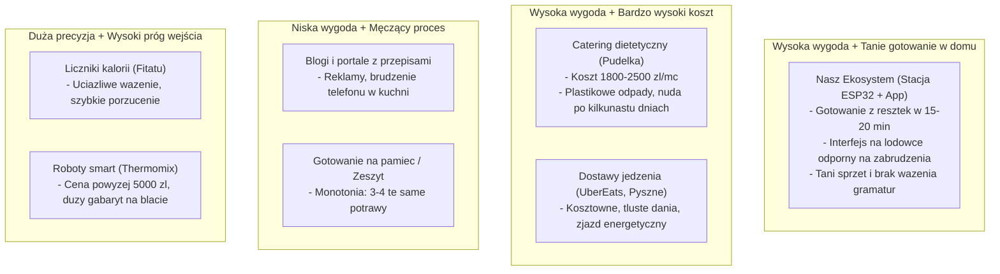

# Analiza Konkurencji i Rynkowych Alternatyw

Zestawienie bezpośrednich i pośrednich rozwiązań, z których korzystają obecnie osoby z grupy docelowej, próbując zorganizować codzienne wyżywienie.

---

## 1. Kontekst Rynkowy

Zanim użytkownik trafi na nowe rozwiązanie, korzysta z dostępnych obecnie narzędzi i usług. Żadne z nich nie rozwiązuje jednak w pełni problemu codziennego gotowania w warunkach ograniczonego czasu i energii po pracy.

Poniższe zestawienie dekonstruuje najpopularniejsze alternatywy pod kątem wygody, kosztów oraz realnego wpływu na nawyki żywieniowe.

---

## 2. Analiza Poszczególnych Rozwiązań

### Kategoria 1: Aplikacje dietetyczne i liczniki kalorii
*(Przykłady: Fitatu, MyFitnessPal, Yazio)*

* **Zasada działania:** Ręczne wprowadzanie gramatury każdego składnika lub skanowanie kodów kreskowych w celu kontroli bilansu kalorycznego i makroskładników.
* **Koszt:** Model freemium lub subskrypcja 120–240 zł rocznie.
* **Zalety:** Dokładna kontrola bilansu energetycznego, bogate bazy produktów spożywczych.
* **Dlaczego użytkownicy z nich rezygnują:**
  * **Uciążliwość codzienna:** Ważenie każdego plasterka pomidora czy łyżki oliwy po kilku dniach wywołuje zniecierpliwienie. Większość użytkowników porzuca wpisywanie posiłków po 2–3 tygodniach.
  * **Brak pomocy w przygotowaniu posiłku:** Aplikacja informuje, ile kalorii zjadł użytkownik, ale nie podpowiada, co ugotować z produktów leżących w lodówce.
  * **Ignorowanie jakości biologicznej:** Liczniki skupiają się na gramach białka i węglowodanów, nie promując różnorodności gatunkowej roślin ani zdrowia mikrobiomu.

---

### Kategoria 2: Serwisy i aplikacje z przepisami
*(Przykłady: Kwestia Smaku, Przepisy.pl, Cookpad, AniGotuje)*

* **Zasada działania:** Wyszukiwarki przepisów kulinarnych filtrowane według kategorii, okazji lub wybranych składników.
* **Koszt:** Bezpłatne (z reklamami) lub niewielkie opłaty abonamentowe.
* **Zalety:** Dobre zdjęcia gotowych dań, szeroki wybór tradycyjnych i nowoczesnych przepisów.
* **Dlaczego nie sprawdzają się na co dzień:**
  * **Niewygodna obsługa w kuchni:** Wymuszają ciągłe dotykanie ekranu telefonu mokrymi rękami, ekran wygasza się w trakcie gotowania, a użytkownik musi przedzierać się przez długie wstępy i wyskakujące banery reklamowe.
  * **Nierealistyczne listy składników:** Większość przepisów wymaga posiadania przypraw lub dodatków, których nie ma w typowej lodówce, co zmusza do wyjścia do sklepu.
  * **Zbyt duży wybór:** Setki przepisów na „szybki obiad z makaronem” pogłębiają paraliż decyzyjny zmęczonego użytkownika.

---

### Kategoria 3: Catering dietetyczny (dieta pudełkowa)
*(Przykłady: Maczfit, Nice To Fit You, Body Chief)*

* **Zasada działania:** Codzienna poranna dostawa 3–5 gotowych dań w hermetycznych tackach pod drzwi.
* **Koszt:** 60–90 zł dziennie (1800–2700 zł miesięcznie na osobę).
* **Zalety:** Całkowity brak konieczności robienia zakupów, gotowania i zmywania naczyń.
* **Dlaczego nie jest to rozwiązanie na stałe:**
  * **Wysoki koszt miesięczny:** Zbyt duże obciążenie budżetu dla młodego pracownika lub studenta na dorobku.
  * **Znużenie smakiem i zjawisko rezygnacji:** Średni czas utrzymania subskrypcji w Polsce wynosi ok. 10 dni. Odgrzewane w mikrofali jedzenie po kilkunastu dniach staje się monotonne w smaku i teksturze.
  * **Kwestia odpadów:** Codzienne generowanie kilku plastikowych pojemników kłóci się z rosnącą świadomością ekologiczną grupy docelowej.

---

### Kategoria 4: Zaawansowane roboty kuchenne
*(Przykłady: Thermomix TM6, Silvercrest Monsieur Cuisine / Lidlomix)*

* **Zasada działania:** Wielofunkcyjne urządzenia kuchenne z wbudowanym ekranem dotykowym i wagą, prowadzące użytkownika krok po kroku przez przepis.
* **Koszt:** 2500 zł (Lidlomix) do 6455 zł (Thermomix) + roczny abonament na platformę z przepisami (ok. 199 zł/rok).
* **Zalety:** Wygodny ekran bez brudzenia telefonu, automatyzacja procesu gotowania, wysoka powtarzalność.
* **Bariery dla grupy docelowej:**
  * **Bardzo wysoki koszt zakupu:** Wydatek rzędu kilku tysięcy złotych jest poza zasięgiem większości młodych dorosłych wynajmujących mieszkania.
  * **Duże gabaryty:** Urządzenie zajmuje znaczną część blatu w małych aneksach kuchennych wielkomiejskich mieszkań.
  * **Brak wsparcia w gotowaniu z resztek:** Przepisy na platformach typu Cookidoo wymagają zakupu konkretnej listy składników, a nie elastycznego czyszczenia lodówki.

---

### Kategoria 5: Gotowanie z pamięci i notatki w zeszycie
*(Przykłady: Gotowanie kilku znanych potraw na pamięć, karteczki na lodówce)*

* **Zasada działania:** Trzymanie się 3–4 sprawdzonych dań (spaghetti, kurczak z ryżem, jajecznica, tosty).
* **Koszt:** 0 zł.
* **Zalety:** Szybkość przygotowania, brak konieczności szukania instrukcji.
* **Wady:** Skrajna monotonia żywieniowa, brak warzyw w diecie, zniechęcenie po kilku tygodniach i ucieczka w drogi fast food.

---

## 3. Zestawienie Porównawcze Rozwiązań

| Kryterium | Aplikacje dietetyczne (Fitatu) | Serwisy z przepisami (Kwestia Smaku) | Dieta pudełkowa (Maczfit, NTFY) | Roboty kuchenne (Thermomix) | Nasz projekt (ESP32 + Aplikacja) |
| :--- | :---: | :---: | :---: | :---: | :---: |
| **Koszt początkowy** | 0 zł | 0 zł | 0 zł (zamówienie dzienne) | 2500–6455 zł | ~150–200 zł (koszt stacji) |
| **Miesięczny koszt** | 15–20 zł | 0 zł | 1800–2500 zł | ~17 zł (abonament) | 0 zł / opcjonalna subskrypcja |
| **Obsługa w kuchni** | Uciążliwa (telefon) | Uciążliwa (telefon) | Brak (danie gotowe) | Wygodna (duży ekran) | Bardzo wygodna (stacja na lodówce, fizyczne pokrętło) |
| **Zajmowane miejsce** | Brak | Brak | Dużo miejsca w lodówce | Duże urządzenie na blacie | 0 cm² blatu (montaż magnetyczny na lodówce) |
| **Wysiłek decyzyjny** | Duży (ważenie, wpisywanie) | Duży (przeglądanie setek dań) | Zerowy | Średni (planowanie zakupów) | Minimalny (2 gotowe propozycje w 10 sekund) |
| **Gotowanie z resztek (Zero-Waste)** | Brak | Słabe (sztywne filtry) | Brak | Umiarkowane | Główny mechanizm działania |
| **Troska o różnorodność roślin** | Brak (tylko makroskładniki) | Zależna od użytkownika | Umiarkowana | Brak mechanizmu | Automatyczny licznik 30 roślin w tle |
| **Wymóg ważenia produktów** | Tak (obowiązkowy) | Często | Nie | Wbudowana waga | Całkowity brak (miary garściowe) |

---

## 4. Pozycjonowanie na Rynku

---

## 5. Działania Wyróżniające Projekt

W odróżnieniu od istniejących rozwiązań, nasz projekt opiera się na 4 filarach projektowych:

1. **Wyeliminowanie ważenia składników i brudzenia telefonu:** Zamiast kazać użytkownikowi ważyć każdy gram produktu na wadze i przewijać telefon tłustymi rękami, wprowadzamy miary intuicyjne (garść, łyżka) oraz stację ze sterowaniem fizycznym pokrętłem montowaną na lodówce.
2. **Skrócenie czasu decyzji do minimum:** Zamiast katalogu 500 przepisów system serwuje użytkownikowi 2 konkretne propozycje obiadu dopasowane do tego, co aktualnie znajduje się w spiżarni i lodówce.
3. **Praktyczny Zero-Waste:** Algorytm w pierwszej kolejności wykorzystuje produkty napoczęte i te z krótką datą ważności, ograniczając cotygodniowe wyrzucanie zwiędłych warzyw.
4. **Wsparcie zdrowia w tle:** Realizacja zaleceń Talerza Zdrowia oraz zasady 30 roślin tygodniowo odbywa się bez nudnego wykładu dietetycznego – po prostu odpowiednio komponujemy sugerowane dania.

---

## 6. Wnioski dla Projektu

1. **Konkurencja z blogami kulinarnymi nie ma sensu:** Naszą przewagą nie jest liczba wymyślnych przepisów, lecz szybkość wyboru i prostota wykonania z podstawowych składników.
2. **Sprzęt chroni przed porzuceniem aplikacji:** Zwykłe aplikacje w telefonie szybko się nudzą i lądują w zapomnieniu. Fizyczna obecność małej stacji na drzwiach lodówki sprawia, że wciśnięcie przycisku staje się naturalnym nawykiem po wejściu do kuchni.
3. **Cena podzespołów musi pozostać niska:** Koszt produkcji prototypu na ESP32 musi zamknąć się w kwocie poniżej 70–80 zł, aby finalne urządzenie było powszechnie dostępne dla studentów i młodych specjalistów.
