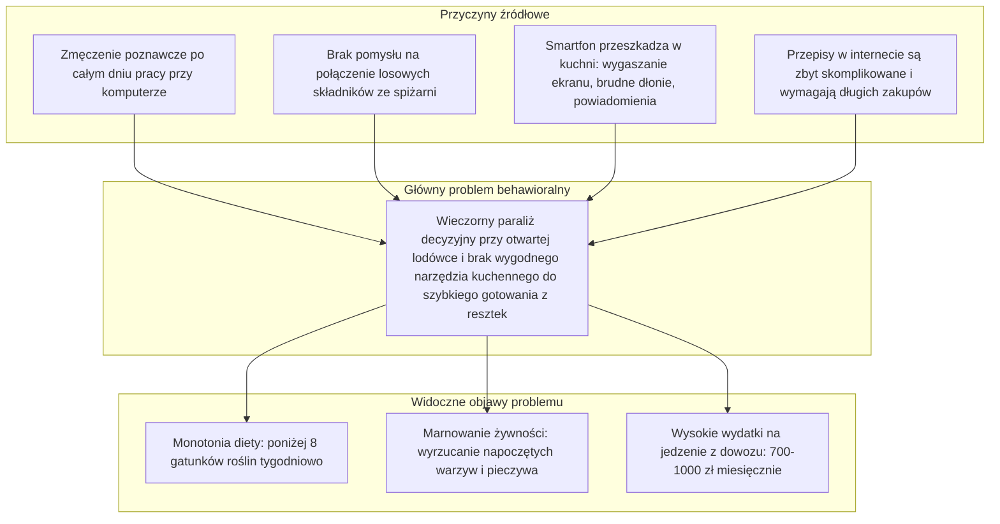

# Definicja Problemu: Problem Statement, Pytania HMW i Value Proposition Canvas

Synteza fazy badawczej i wyznaczenie jednoznacznego kierunku dla etapu projektowania i budowy prototypu (Develop & Deliver).

---

## 1. Rola i Cel Dokumentu

Po etapie wywiadów, ankiet i analizy konkurencji zebrane wnioski zostały zsyntetyzowane w jeden, konkretny problem projektowy. Niniejszy dokument stanowi punkt wyjścia do prac inżynierskich i programistycznych: określa, dla kogo dokładnie budujemy rozwiązanie, z jakim realnym problemem się mierzymy oraz jakimi kryteriami będziemy oceniać efekty.

---

## 2. Analiza Przyczyn Źródłowych (Root Cause Analysis)

Na podstawie rozmów z użytkownikami przeprowadziliśmy analizę metodą 5 Why, aby oddzielić widoczne objawy (monotonia diety, wyrzucanie jedzenia) od ich rzeczywistych przyczyn:

---

## 3. Zdefiniowane Stanowisko Projektowe (Problem Statement / POV)

### Użytkownik:
Młody pracownik umysłowy lub student w wieku 20–34 lata, mieszkający w dużym mieście, który chce jeść smacznie, zdrowo i oszczędnie, ale po pracy brakuje mu energii.

### Potrzebuje:
Sposobu na natychmiastowe podjęcie decyzji obiadowej i poprowadzenie przez szybkie gotowanie (poniżej 20 minut) z wykorzystaniem tego, co już ma w kuchni, bez konieczności dotykania smartfona.

### Ponieważ:
Po 8 godzinach pracy przy ekranie doświadcza paraliżu decyzyjnego, a uciążliwe szukanie przepisów w telefonie brudnymi rękami popycha go do zamawiania drogiego fast foodu, marnowania zepsutych resztek z lodówki i jedzenia w kółko tych samych kilku dań.

---

## 4. Główne Pytania Projektowe (How Might We)

Pytania HMW przekładają zidentyfikowane problemy na konkretne zadania projektowe dla zespołu hardware i software:

### HMW 1: Architektura decyzji
> **Jak moglibyśmy skrócić czas wyboru posiłku z kilkunastu minut do poniżej 30 sekund bezpośrednio przy lodówce, nie obciążając zmęczonego użytkownika?**
*Kierunek:* Zamiast wyszukiwarki z setkami opcji, podanie maksymalnie 2 trafnych propozycji dań dopasowanych do posiadanych składników.

### HMW 2: Ergonomia kuchenna
> **Jak moglibyśmy umożliwić wygodne gotowanie krok po kroku bez konieczności dotykania i wygaszania ekranu telefonu brudnymi dłońmi?**
*Kierunek:* Dedykowany, tani moduł na lodówce (ESP32) ze sterowaniem fizycznym pokrętłem lub prostym sensorem zbliżeniowym.

### HMW 3: Wsparcie mikrobiomu
> **Jak moglibyśmy w naturalny sposób podnieść różnorodność diety użytkownika do poziomu 30 różnych roślin tygodniowo bez zmuszania go do liczenia kalorii i ważenia gramatur?**
*Kierunek:* Algorytm w tle promujący dodawanie prostych dodatków (pestki, mrożonki, kasze, przyprawy, strączki) w sugerowanych przepisach.

### HMW 4: Ograniczenie marnotrawstwa
> **Jak moglibyśmy zmniejszyć wyrzucanie otwartych produktów w lodówce o co najmniej połowę, zamieniając resztki w pełnowartościowe posiłki?**
*Kierunek:* Logika spiżarni priorytetyzująca składniki o krótkiej trwałości i sugerująca zamienniki w przepisach.

### HMW 5: Wygoda w cenie domowego jedzenia
> **Jak moglibyśmy zaoferować prostotę zbliżoną do diety pudełkowej przy trzykrotnie niższym koszcie i świeżym smaku domowego gotowania?**
*Kierunek:* Minimalistyczny proces: podejście do lodówki, wybór dania jednym kliknięciem, 15 minut przy patelni i gotowe.

---

## 5. Dopasowanie Wartości (Value Proposition Canvas)

| Element profilu klienta | Odpowiedź naszego ekosystemu (Hardware + App) |
| :--- | :--- |
| **Zadanie klienta (Job):** Szybko zjeść sycący obiad po powrocie z pracy. | **Produkt:** Prosta stacja kuchenna na lodówce (ESP32) + aplikacja ze stanem spiżarni. |
| **Zadanie klienta (Job):** Wykorzystać otwarte produkty przed upływem terminu ważności. | **Uśmierzacz bólu:** Algorytm dobierający przepisy pod kątem resztek w lodówce. |
| **Ból (Pain):** Pustka w głowie o 18:00 i brak pomysłu na obiad. | **Uśmierzacz bólu:** 2 konkretne propozycje obiadu wyświetlane natychmiast na ekranie stacji. |
| **Ból (Pain):** Irytujące odblokowywanie telefonu mokrymi rękami i wygaszający się ekran. | **Uśmierzacz bólu:** Wyświetlacz OLED/e-Paper na lodówce i sterowanie fizycznym pokrętłem z przyciskiem. |
| **Ból (Pain):** Poczucie winy z powodu wyrzucania zepsutej zieleniny i warzyw. | **Uśmierzacz bólu:** Przepisy elastyczne, które pozwalają wrzucić dowolne napoczęte warzywa. |
| **Korzyść (Gain):** Zaoszczędzony czas i wolny wieczór bez stania przy garnkach przez godzinę. | **Kreator korzyści:** Przepisy zamykające się w czasie do 20 minut z minimalną liczbą naczyń do zmywania. |
| **Korzyść (Gain):** Oszczędność kilkuset złotych miesięcznie na jedzeniu z dowozu. | **Kreator korzyści:** Domowe gotowanie oparte na tanich podstawowych składnikach. |
| **Korzyść (Gain):** Lepsze samopoczucie i różnorodna dieta bez skomplikowanych diet. | **Kreator korzyści:** Automatyczny licznik 30 roślin w skali tygodnia realizujący wytyczne Talerza Zdrowia. |

---

## 6. Kryteria Gotowości do Fazy Budowy Rozwiązania

Przed przejściem do etapu tworzenia prototypu zweryfikowaliśmy kluczowe założenia:

* [x] **Problem jest powszechny:** 49,3% ankietowanych cierpi na zmęczenie decyzyjne po pracy, a 84,5% przyznaje się do regularnego lub sporadycznego wyrzucania żywności.
* [x] **Problem generuje realne straty:** Średnio 700–900 zł miesięcznie wydawane na jedzenie z dowozu oraz 200–350 zł w wyrzuconych resztkach.
* [x] **Obecne rozwiązania mają luki:** Aplikacje mobilne przeszkadzają w kuchni, catering jest zbyt drogi na dłuższą metę, a roboty kuchenne kosztują kilka tysięcy złotych.
* [x] **Rozwiązanie jest technicznie wykonalne:** Tani moduł ESP32 z ekranem i enkoderem pozwala zrealizować założenia sprzętowe przy budżecie podzespołów poniżej 70–80 zł.
