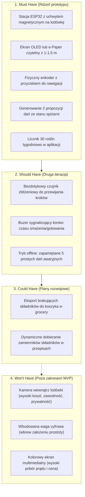

# Karta Projektu i Wymagania Techniczne (Design Brief)

Specyfikacja wymagań, kryteria sukcesu oraz ograniczenia techniczne i harmonogram dla fazy budowy prototypu (Develop & Deliver).

---

## 1. Cel Projektu

Stworzenie zintegrowanego systemu składającego się z taniej stacji kuchennej IoT (opartej na mikrokontrolerze ESP32) oraz powiązanej aplikacji mobilnej. System ma na celu:
1. Zredukowanie czasu wyboru posiłku po pracy do kilkunastu sekund.
2. Zmniejszenie ilości marnowanej żywności w gospodarstwie domowym o min. 40% poprzez gotowanie z resztek (pantry-first).
3. Podniesienie tygodniowej różnorodności roślinnej w diecie (dążenie do 30 gatunków roślin) bez konieczności ważenia gramatur i liczenia kalorii.

Fizyczna stacja kuchenna montowana na lodówce pełni funkcję bezpośredniego punktu styku, który ułatwia wyrobienie nawyku gotowania i zapobiega porzuceniu aplikacji po kilku dniach.

---

## 2. Metryki Sukcesu i Wskaźniki Projektu

### Główna Metryka Projektu (North Star Metric)
* **Liczba obiadów przygotowanych przy użyciu stacji w tygodniu per aktywny użytkownik**
  *Cel docelowy w testach pilotażowych:* minimum 4 posiłki tygodniowo, co potwierdza trwałe wejście urządzenia w rytm dnia.

### Metryki Użytkowe
* **Czas do podjęcia decyzji:** Średni czas od podejścia do lodówki do wyboru dania poniżej 30 sekund (zmierzone telemetrycznie na urządzeniu).
* **Czas przygotowania posiłku:** Co najmniej 80% sugerowanych dań możliwe do ugotowania w czasie poniżej 20 minut.
* **Liczba roślin w diecie:** Wzrost z poziomu 7–9 roślin tygodniowo do minimum 25–30 unikalnych gatunków po 4 tygodniach korzystania z systemu.
* **Redukcja marnowania jedzenia:** Spadek deklarowanej wagi lub wartości wyrzucanych produktów o min. 40% (ankiety diary study).

### Wskaźniki Techniczno-Biznesowe
* **Koszt podzespołów (BOM):** Koszt elementów pojedynczego prototypu poniżej 70–80 zł (docelowo poniżej 10 USD przy produkcji małoseryjnej).
* **Stabilność połączenia i czas wybudzenia:** Czas od kliknięcia enkodera do wyświetlenia propozycji obiadu poniżej 4 sekund.
* **Czas pracy na baterii:** Minimum 2–3 tygodnie na jednym ładowaniu ogniwa Li-Po przy standardowym użyciu 2–3 razy dziennie.

---

## 3. Zakres Funkcjonalny MVP (MoSCoW)

### 3.1. Must Have (Konieczne do działającego prototypu)
* **Urządzenie ESP32:**
  * Mikrokontroler ESP32 z Wi-Fi.
  * Wyświetlacz monohromatyczny OLED (0.96" lub 1.3") lub e-Paper o wysokim kontraście.
  * Enkoder obrotowy z przyciskiem (Rotary Encoder).
  * Obudowa z tworzywa sztucznego z magnesami neodymowymi (druk 3D).
  * Zasilanie z akumulatora Li-Po z ładowaniem USB-C i obsługą Deep Sleep.
* **Firmware:**
  * Komunikacja z API backendu przez REST / MQTT.
  * Zwięzłe wyświetlanie kroków przepisu (maksymalnie 3 linijki na ekran) + wbudowany minutnik.
* **Aplikacja mobilna:**
  * Prosty menedżer spiżarni oparty na szybkich tagach (dodawanie produktów bez wpisywania gramatur).
  * Algorytm dobierający 2 dania na podstawie dostępnych składników.
  * Tygodniowy licznik unikalnych roślin.

### 3.2. Should Have (Wskazane po pierwszych testach)
* Czujnik zbliżeniowy (np. APDS-9960) umożliwiający przewijanie kroków gestem dłoni w powietrzu.
* Prosty buzer piezoelektryczny informujący o zakończeniu odliczania minutnika.
* Tryb pamięci podręcznej w pamięci flash ESP32 na wypadek braku połączenia z domowym Wi-Fi.

### 3.3. Could Have (Przyszłe iteracje)
* Automatyczne przekazywanie brakujących produktów do koszyka w sklepach e-grocery (Frisco, Biedronka).
* Dynamiczne dopasowywanie nietypowych resztek i sugerowanie kulinarnych zamienników.

### 3.4. Won't Have (Świadomie wykluczone z projektu)
* Kamery montowane wewnątrz lodówki do rozpoznawania produktów – zbyt wysoki koszt, problemy z zaparowanym obiektywem i wątpliwa niezawodność przy warstwowym ułożeniu jedzenia.
* Wbudowana waga cyfrowa – cel projektu zakłada rezygnację ze żmudnego ważenia na rzecz intuicyjnych miar domowych (garść, łyżka, sztuka).
* Duży kolorowy tablet – zbyt drogi, rozpraszający uwagę i wymagający stałego podłączenia do kabla zasilającego.

---

## 4. Ograniczenia i Wymagania Środowiskowe

### 4.1. Środowisko kuchenne i mechanika
* **Wilgoć i tłuszcz:** Obudowa musi chronić elektronikę przed parą wodną i zachlapaniami (minimum standardu odpowiadające IP54; brak szczelin bezpośrednio nad płytką PCB).
* **Montaż:** Magnesy neodymowe wbudowane w tylną ściankę obudowy muszą pewnie utrzymywać stację na drzwiach lub boku lodówki podczas zamykania drzwi.

### 4.2. Zasilanie i bilans energetyczny
* **Tryb uśpienia:** Mikrokontroler ESP32 musi przechodzić w tryb Deep Sleep (pobór prądu poniżej $15\ \mu\text{A}$) po 60 sekundach bezczynności.
* **Wybudzanie:** Natychmiastowe wybudzenie przerwaniem sprzętowym (Wake-on-Interrupt) po naciśnięciu lub obróceniu enkodera.
* **Bateria:** Akumulator Li-Po o pojemności min. 1000–1200 mAh zapewniający minimum 14–20 dni pracy bez doładowywania.

### 4.3. Ergonomia i interfejs
* **Czas reakcji:** Czas od naciśnięcia przycisku do wyświetlenia propozycji dań nie może przekraczać 4 sekund.
* **Czytelność:** Krój pisma i rozmiar liter na wyświetlaczu muszą zapewniać bezproblemowe odczytanie instrukcji z odległości 1,2 metra przez osobę stojącą przy blacie kuchennym.

---

## 5. Harmonogram Prac w Drugim Diamencie (8 Tygodni – 4 Sprinty)

Prace w fazie Develop & Deliver podzielono na cztery dwutygodniowe sprinty inżynierskie:

| Sprint | Okres | Zakres zadań inżynierskich | Wynik etapu i mierzalny kamień milowy |
| :--- | :---: | :--- | :--- |
| **Sprint 1: Architektura i PoC sprzętowe** | Tydzień 1–2 | Uruchomienie układu bazowego na płytce stykowej (ESP32 NodeMCU, wyświetlacz OLED 0.96"/1.3", enkoder obrotowy). Opracowanie schematu połączeń, projektu bazy danych oraz specyfikacji REST/MQTT API. | Działający układ testowy (nawigacja tekstem za pomocą enkodera) + działający szkielet backendu. |
| **Sprint 2: Firmware ESP32 i obudowa CAD** | Tydzień 3–4 | Implementacja firmware'u w C++/Arduino (obsługa Wi-Fi, komunikacja z API, obsługa trybu Deep Sleep z wybudzaniem przerwaniem fizycznym). Projekt obudowy z mocowaniem magnetycznym w programie CAD i próbny wydruk 3D. | Złożona stacja kuchenna w obudowie pobierająca dane testowe przez Wi-Fi i przechodząca w tryb uśpienia. |
| **Sprint 3: Aplikacja mobilna i logika spiżarni** | Tydzień 5–6 | Implementacja interfejsu aplikacji mobilnej (zarządzanie stanem spiżarni, silnik doboru dań z resztek pantry-first, tygodniowy licznik 30 roślin). Integracja aplikacji z backendem i stacją kuchenną. | Pełny przepływ użytkownika: dodanie produktów w telefonie -> natychmiastowa propozycja obiadu na stacji. |
| **Sprint 4: Testy integracyjne, pilotaż i obrona** | Tydzień 7–8 | Testy środowiskowe w kuchni (odporność na parę, pomiar realnego czasu pracy na baterii Li-Po, testy gotowania z użytkownikami). Przygotowanie dokumentacji powykonawczej, materiału wideo PoC i prezentacji na obronę. | Zintegrowany, w pełni działający prototyp demonstracyjny gotowy do prezentacji i obrony projektu. |

---

## 6. Podsumowanie Gotowości

Opracowanie niniejszego briefu zamyka etap analiz i definicji problemu. Zespół dysponuje sprecyzowanym zakresem prac, zweryfikowanymi założeniami użytkowników oraz precyzyjnymi ramami budżetowymi i technologicznymi, co pozwala przejść bezpośrednio do prac montażowych i programistycznych.
